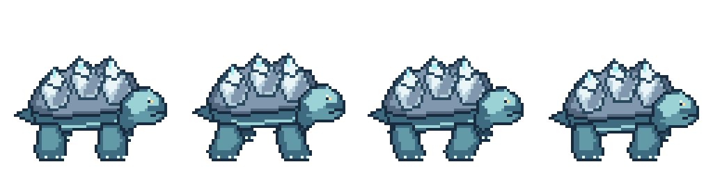
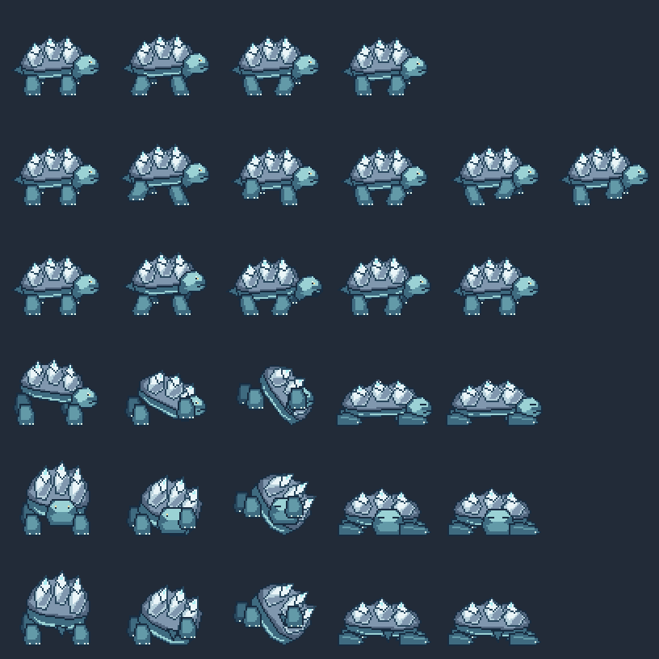

# Shellback v3 review

| Prior v2 | New right | B04 Puffcap |
|---|---|---|
|  |  |  |

Cycle 6 Shellback v3: six strips / 30 cells revised, existing PR #61. Right idle bbox 220x152 first frame, low shell with separate ridge spikes, plastron and alternating visible foot lift, exposed neck extension. Death has rotated shell recoil, tipping, rim contact, wider settled closed-eye pose and intentionally held final frame. Native bounds and y231 anchor checked; 4x hard-alpha construction. Full audit and independent PNG decode/hash comparison not run. Down move and attack minor nits remain from v2; front/rear death continuity, apparent shell/limb contact and exact lunge displacement need review. Existing other six strips retained. No code changes.