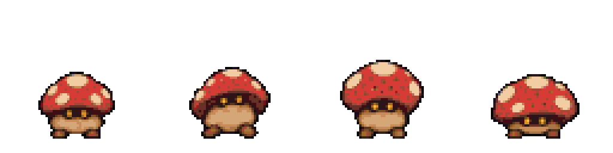
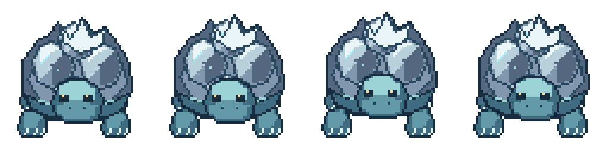
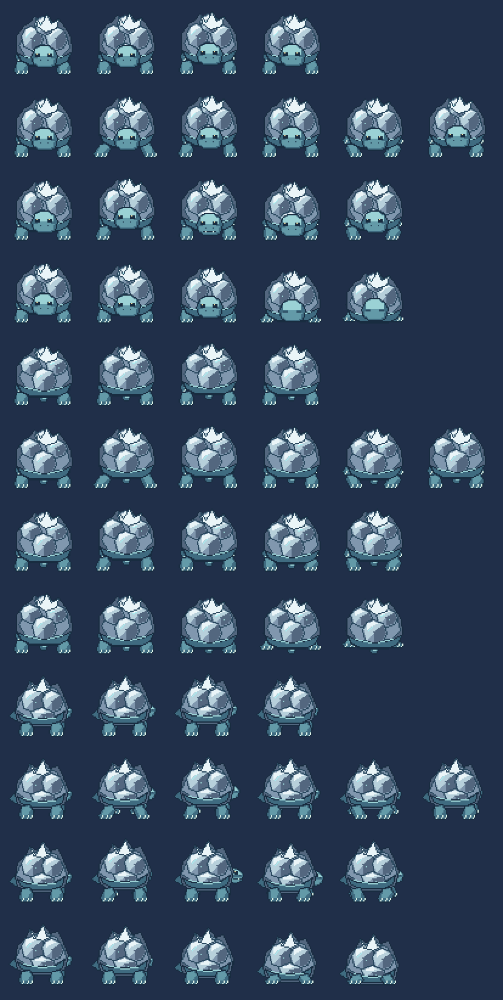

# Glacier Shellback — WIP review

| Existing B04 Puffcap reference | New Shellback down idle |
| --- | --- |
|  |  |

Rows 1–4: down idle, move, attack, death. Rows 5–8: up idle, move, attack, death. Rows 9–12: right idle, move, attack, death. Frames left to right; unused grid positions blank.

This comparison is a Markdown two-column panel, not a combined comparison PNG. The contact sheet was visually checked. The side head needs more separation and the up idle repeats a pose. Death is shell withdrawal, not a literal roll onto its side. Please review and run the repository audit before any merge.
