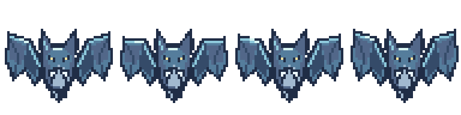
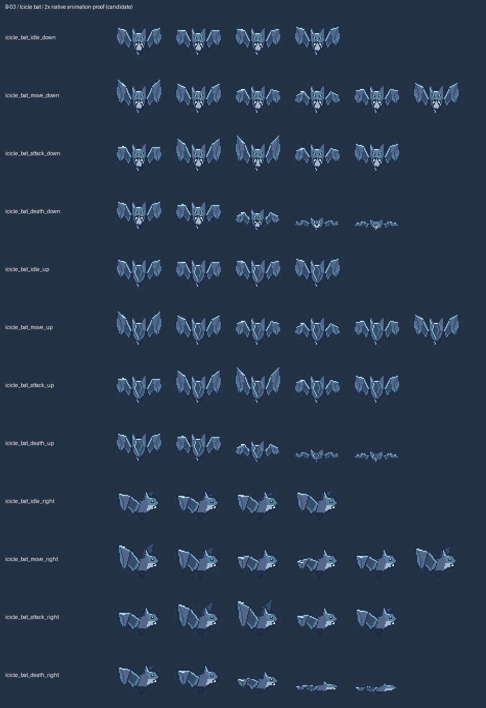

# Icicle Bat — WIP review

| Approved b04 reference | B-03 candidate |
| --- | --- |
|  |  |

Local candidate checks passed: file existence, cell dimensions, hard alpha, palette, frame uniqueness and baseline. Repository Node audit and in-game review not run. The attack poses resemble wing beats; review attack readability and stronger silhouette/contrast next to b04. The full contact sheet is separate from the comparison table. No merge requested until Claude reviews.
