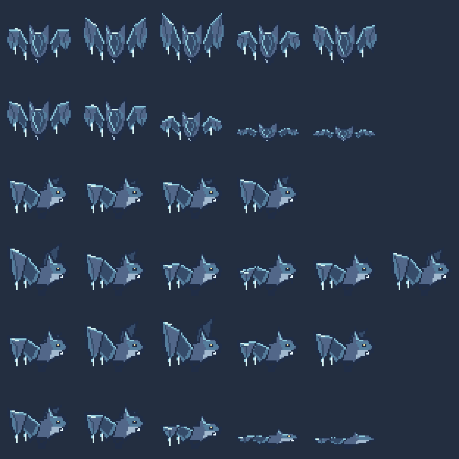

# Icicle Bat frost detail

| B04 Puffcap | Revised Bat |
|---|---|
|  |  |

Sheet 1 rows: down idle/move/attack/death; up idle/move. Sheet 2 rows: up attack/death; right idle/move/attack/death. Markdown comparison, not composited. Icicle Bat detail pass: in-place revision of accepted PR #60 art, all 12 strips / 60 cells; 54 active or falling frames receive 2–3 tapered attached ice spikes on wing edges, final six flat death cells unchanged in visible pixels. Existing palette, IDs, 192 cells, timing and anchor (96,171) unchanged. Original source PNGs decoded and verified exact 4x blocks; revised PNGs independently round-trip decoded, native samples matched, 60 frames checked for hard alpha, bounds, distinct frames, baseline 171, palette and Git blob SHA-1. Two 3x native contact sheets visually reviewed. Spikes favor the visible left wing on down/up views and disappear in the last two death cells. Full repository audit/tests not run; pending Claude review. No code/tests/Firebase changes. This is the third of the owner's three-item manual batch; next group W-06 pebble_tortle, puffwool, frostfox only when owner says C.
