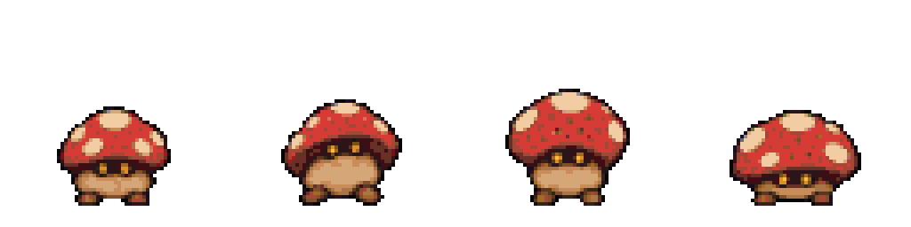
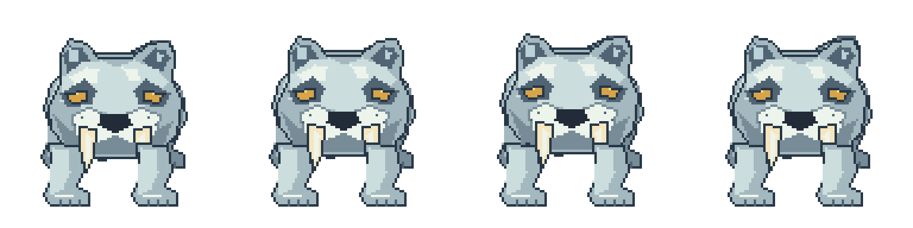
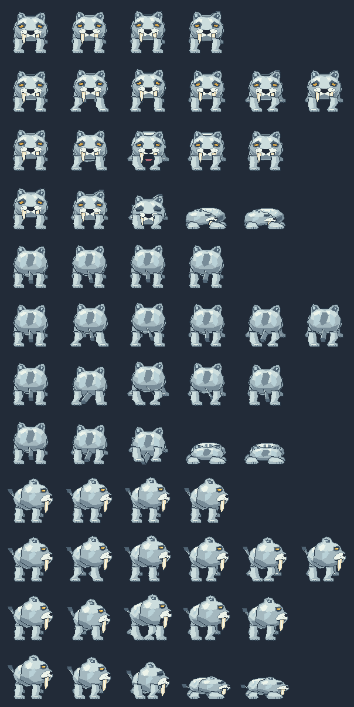

# Comparison and preview

| Existing b04 Puffcap | Sabrefang |
|---|---|
|  |  |

Rows 1–4 down, 5–8 up, 9–12 right; each idle, move, attack, death. Comparison is side-by-side Markdown rather than a combined image. B-03 Sabrefang WIP: original 12 strips / 60 cells, L96 native, 384-cell, anchor (192,347), idle/move per-frame provisional seats. Three directions, icy pale-striped sabre-tooth cat with long ivory canines, crouch/strike/recovery and low final death poses. All native-buffer bounds, hard alpha, baseline, palette and distinct-frame checks passed; Git blob SHA-1 independently computed from generated bytes and matched for all 13 PNGs. Full repository audit and individual PNG decode not run. Contact sheet rendered and inspected. Visual review needed: compact/cubby side silhouette, pale stripes on torso partly hidden by oversized head, modest lunge, feet remain grounded, provisional seat coordinates. Separate saddle overlays next; W-06 exact redraws after B-03 in owner order. No code/tests/Firebase changes.
