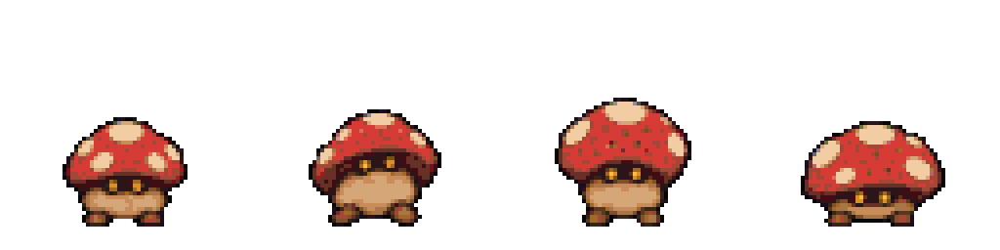
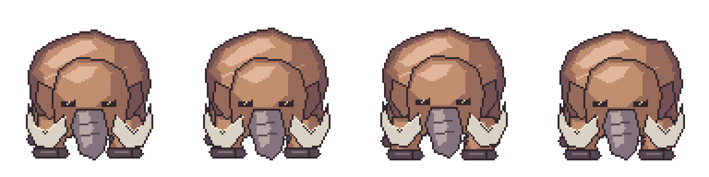
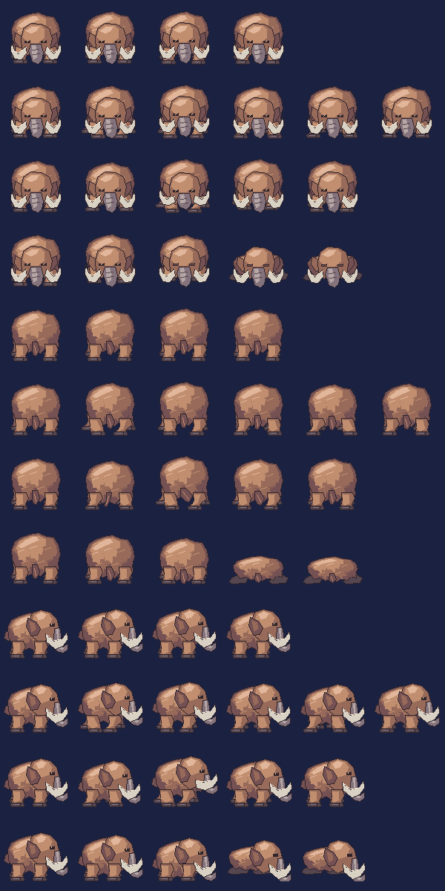

# Shagtusk WIP — visual comparison

| B04 Puffcap reference | Shagtusk down idle |
| --- | --- |
|  |  |

Rows: down, up, right, each idle/move/attack/death. Comparison is side-by-side Markdown, not combined raster. Shagtusk first-pass WIP: 12 original RGBA strips / 60 cells, down/up/right, woolly mammoth silhouette with curved ivory tusks, warm fur and grey trunk. 96 native / 384 cells; anchor assumed (192,347) for L96; existing Tusktop uses y350, so verify in engine. Provisional per-frame rider seats estimated from dorsal coat; no saddle baked in. Native-buffer checks: baseline 347, hard alpha, corners, 8–13 colors, dimensions; 3 attack strips repeat recovery frame. Visual review: front/side death head remains tall and trunk may clip in collapsed poses; fur needs stronger shag clumps, attack readability may need polish. Sleep/eat and saddle overlays deferred (queue specifies 12 enemy strips). Full repository audit and independent strip decode not run; direct connector upload. Next Sabrefang, then saddles, per owner's B-03 sequence. W-06 remains queued per Claude. No code/tests/Firebase changed.
