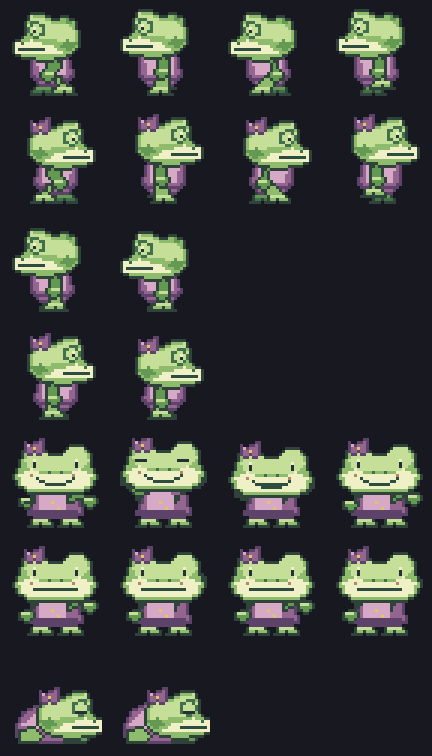

# Lily v2 partial

Cycle 7 Lily v2 partial redo: seven strips/22 cells revised; true profile torso, single near arm, connected alternating webbed feet, bow appears on visible side, happy emote and lying sleep. Native buffer checks: all baseline 119, happy 4 distinct, wave 3 distinct, sleep 2 distinct. WIP: right walk f2/f4 and happy/wave touch top row, sleeping snout touches right edge; shorten bow and shift sleeping head left. Wave paw is obscured by the head; redraw foreground paw. Nine variants, animated grid, comparisons, independent PNG decode/hash and full audit pending. Other six base strips unchanged. No code changes.
