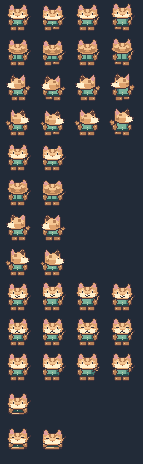

# Mocha WIP

T01 Mocha (coolcats): original ginger tabby in teal cardigan, 13 strips/39 frames, 32 native /128 export, all four directions, sit, sleep and happy/sad/wave. Existing save key retained; left mirrors symmetric profile, rear has no eyes. Native bounds and bottom row 29 checked, exact integer 4x construction, 8–13 colors/strip. Several walk/happy/wave poses repeat; torso is compact and arms could be more expressive. Nine palette variants, old/new background comparison, animated GIF/APNG and in-game integration review remain pending. No independent PNG decode/hash comparison or repository audit run. No code changes. New owner priority from Claude branch followed.
