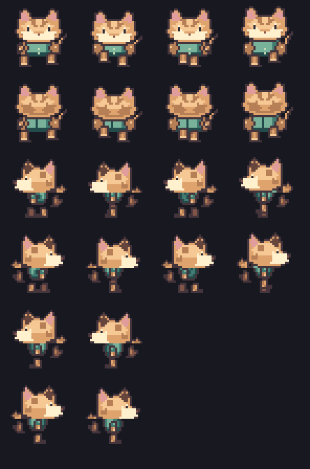
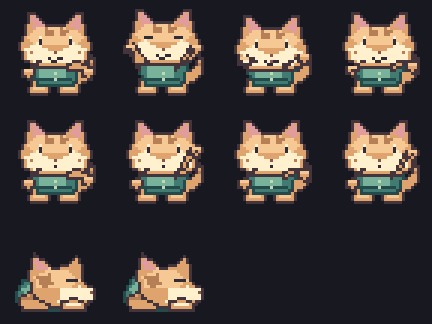

# Mocha v3 partial

Cycle 7 Mocha v3 emote redo: three strips/10 frames, all distinct within strip; happy has changing head/arm pose, wave raised beside head in f2/f4, sleep lying with subtle breathing. Native bounds and baseline 119 passed; 4x hard alpha construction. New head matches original tabby palette but facial proportions differ slightly. Sleep breathing subtle. Previous v2 profile ankle attachment needs polish; nine recolors, animated grid, comparison panel, independent PNG decode/hash and full audit remain outstanding. No code changes.
