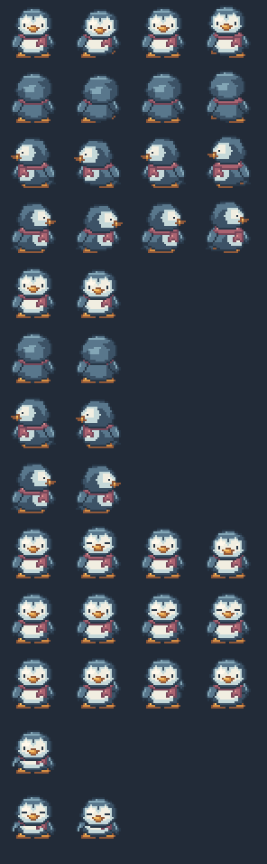

# Frosty WIP

Town Frosty (pudgypenguins, T02 by species; owner sequence calls all five T01): original blue-gray penguin with rose scarf, 13 strips/39 frames, 32 native /128 export, all four directions, sit, sleep and happy/sad/wave. Existing save key retained; true rear, profile beak, alternating waddle and flipper wave. Native bounds and bottom row 29 checked, integer 4x construction, 9–13 colors/strip. Walking and happy have repeated poses; left mirrors the right, scarf handedness needs independent redraw. Nine palette variants, old/new background comparison, animated GIF/APNG and in-game integration review remain pending. No independent PNG decode/hash comparison or repository audit run. No code changes. New owner priority followed.
