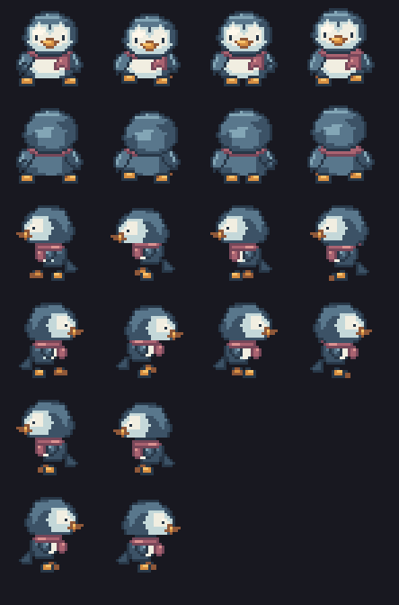

# Frosty v2 partial

Cycle 7 Frosty WIP partial redo: six strips/20 frames revised. Preserved existing head pixels, replaced side torso with curved belly profile, one near flipper, rear tail and offset feet; scarf end moved asymmetrically. All four walk frames distinct; native bounds, hard alpha, baseline 119, source and output PNG roundtrip checks passed. Visual review: profile is somewhat narrow; scarf and feet need connection/shape refinement. Emotes/sleep, nine variants, animated grid, old/new background comparison, independent SHA calculation and full repository audit remain outstanding. No code changes.
