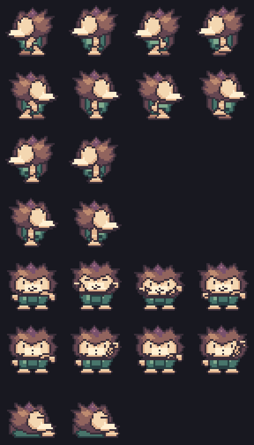

# Spike v2 partial

Cycle 7 Spike v2 partial redo: seven strips/22 cells revised. Narrow profile torso with one visible arm, offset connected legs, shaded far foot, quilled rear silhouette; left/right symmetrical mirror. Happy and wave have four distinct poses, raised paw visible in f2/f4; sleep is low and lying but the two sleep frames are identical, so add visible breathing. All native bounds and baseline 119 passed, 4x hard alpha construction. Profile eye small; check readability at native size. Nine variants, animated grid, comparison panel, independent PNG decoding/hash verification and full audit pending. Other six original strips retained. No code changes.
