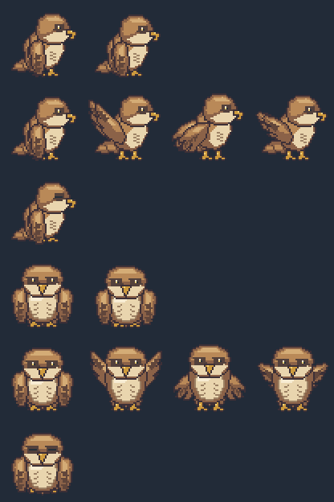
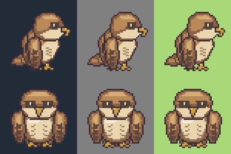

# Hawk

T17 hawk: six strips/14 frames, 48 native/192 export, full body with hooked bill, banded feathers, fan tail and talons, front/right views, four distinct flight poses each. Bounds, feet baseline y183, native distinctness, hard-alpha construction and exact Git blob hashes checked. Reviewed native contact sheet and new sprite on three backgrounds. Caught pose closed eyes; side near wing can read as a tail extension and flight anatomy needs review. No independent PNG decode, old SVG comparison or full audit run. Manual provisional INDEX because ingest not available. No code changes.

## v2
T17 hawk v2: six strips / 14 frames redrawn, same IDs and 192px cells. Slim front silhouette (19 native px wide), compact brow, cream streaked chest, yellow legs and hooked bill, long rufous tail. Profile downstroke now drops below belly, flight f2/f3 body rises 4/5 native px with tucked feet, caught eyes are small eyelid lines. Local Pillow independent PNG decode, hard alpha, exact 4x grid, bounds, distinct frames and Git SHA comparison passed on all six. Airborne bottom rows intentionally 163–175 rather than 183. Added class ff_hawk. Visual inspection on grass completed. Full repository audit/tests unavailable: Git DNS failure. Owl comparison, old SVG comparison, half-native in-game review and updated committed preview pending; no code changes. WIP, do not merge before review.
