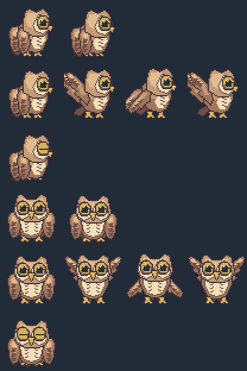

# Owl

T17 owl: six strips/14 frames, 48 native/192 export, feathered full-body owl with ear tufts, amber eyes, barred breast, profile and front, folded/upstroke/downstroke wings and closed-eye caught pose. Native palette and frame counts checked; preview visually reviewed. WIP: flight wing tips contact cell edges, flight f2/f4 repeat, caught poses reach native row 46 rather than 45 (4 exported px below anchor). Shorten wings and correct caught baseline before acceptance. No independent PNG decode/hash verification or repository audit run. Old SVG and in-game comparison pending. No code changes.
